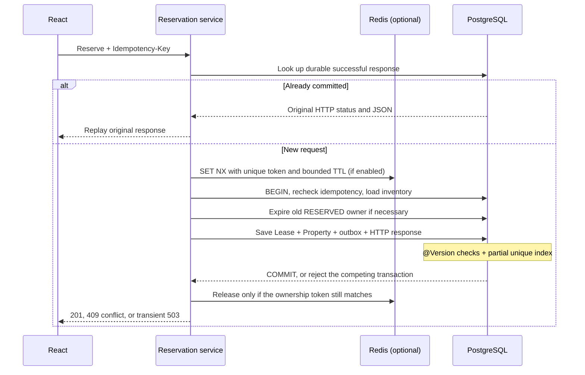

# LeaseFlow — Reservation Lab

A Java 21 / Spring Boot backend and React + TypeScript test interface for property
reservations. Competing requests run against real PostgreSQL transactions. The
interface shows actual availability, committed responses, and measured concurrency
outcomes; it does not simulate successful bookings.

## Run it locally

Requirements: Java 21, Node.js 22.12+ (or a supported newer release), Docker Desktop
running, and network access to Maven Central and npm for the first installation.

Start everything from one terminal with:

```sh
./start-local.sh
```

The launcher installs frontend dependencies, starts PostgreSQL/Redis, launches both
apps, and checks their HTTP readiness. It keeps running until Ctrl+C; logs are saved
in `target/local/`. It stops its app processes on exit and leaves database containers
running. The equivalent manual steps are below.

From this project folder:

```sh
# 1. Start the local infrastructure.
docker compose up -d --wait postgres redis
```

In one terminal:

```sh
# 2. Start the backend on 127.0.0.1:8080 with isolated demo sessions enabled.
./mvnw spring-boot:run -Dspring-boot.run.profiles=local
```

In another terminal:

```sh
# 3. Install and start the React interface.
npm --prefix web install
npm --prefix web run dev
```

Open **http://127.0.0.1:5173**. Vite proxies `/api` to the Java backend so cookies and
CSRF work on the same origin. Keep both terminals running while testing. An installed
compatible Maven can replace `./mvnw` if the wrapper's Maven download is unavailable.

The frontend is a separate `web/` directory because it has its own npm build. The
Java application remains directly in `src/` with a single root `pom.xml`.

```text
leaseplatform/
  pom.xml
  src/main/java/          # HTTP API, reservation transactions, domain, persistence
  src/main/resources/    # configuration and Flyway migrations
  src/test/java/         # domain, service, admission and HTTP/security tests
  src/integration-test/  # real PostgreSQL / Redis integration tests
  web/                   # React + TypeScript + TanStack Query + Vite
  compose.yml            # local PostgreSQL and Redis
```

## Try the double-booking protection

1. **Reserve a property.** The server generates a lease ID and commits a 15-minute
   hold. The current property version and countdown appear on its card.
2. **Replay Reserve with the same key.** The server returns the original `201`
   response and exact JSON, without creating another lease.
3. **Cancel your reservation.** The hold is released transactionally. Replaying the
   earlier Reserve still shows the original response; availability is fetched
   separately from the current database state.
4. **Open Concurrency lab.** Choose 10, 100, or 1,000 attempts and run the test. Every
   attempt calls the same reservation service with its own key and contender ID.
5. **Compare Redis on/off.** The runner uses a fresh isolated property each time and
   shows successful reservations, unavailable rejections, lock contention,
   optimistic-lock conflicts, unique-constraint conflicts, unexpected errors,
   elapsed time, the live-lease count, and the final property ownership pointer.

A run is marked **Verified** only when it has exactly one successful reservation,
exactly one live lease, matching property ownership, `RESERVED` property status,
and zero unexpected errors. The results panel never invents benchmark numbers.
The runner submits at most 1,000 attempts through a pool of at most **32 simultaneous
workers**; 1,000 attempts does not mean 1,000 simultaneous database connections.

If Redis is enabled but unavailable, the service returns a `503` rather than silently
changing modes. Start Redis or explicitly choose database-only mode in the lab.
For the normal Reserve button, start the backend with `LEASEFLOW_REDIS_ENABLED=false`
to use database-only mode.

## Why double reservations cannot commit



- Property and Lease share the same PostgreSQL database and transaction. Redis
  admission is acquired outside that transaction and released after commit/rollback.
- Both entities use JPA `@Version` optimistic locking. A stale transaction cannot
  overwrite a concurrent change.
- A partial unique index on `lease(property_id)` covers `RESERVED`, `CONFIRMING`,
  `COMPENSATING`, and `BOOKED`. PostgreSQL refuses a second live lease even when
  multiple processes enter the critical section or a Redis TTL expires early.
- A deferred composite foreign key ensures `property.active_lease_id` references
  an existing lease for that same property. Available properties have no owner.
- Cancellation and expiration verify property status, property ID, active Lease ID,
  and allowed Lease state before changing both records. A delayed old cancellation
  cannot release a newer lease.
- Expired holds can be replaced in one transaction. The old terminal Lease update
  is flushed before inserting the successor to respect the partial unique index.
- PostgreSQL `clock_timestamp()` determines deadline checks. The worker expires only
  `RESERVED` leases; a `CONFIRMING` lease is not released by the original hold timer.
- Only successful HTTP results are stored under `(userId, operation, key)`, alongside
  the request's SHA-256 identity. A key used for another resource returns `422`.
  Concurrent retries reconcile from a fresh transaction after rollback.
- Redis release uses an atomic token-checking Lua script. An expired owner cannot
  delete a successor's lock. Redis failure is fail-closed when admission is enabled.

Redis reduces admission contention; PostgreSQL provides authoritative correctness.
The lab intentionally lets you observe both configurations.

## API

| Method | Endpoint | Behavior |
| --- | --- | --- |
| GET | `/api/v1/csrf` | Get the session CSRF token and its header name |
| POST | `/api/v1/demo/session` | Create/reuse an isolated server-managed demo session |
| GET | `/api/v1/properties` | List that session's three demo properties |
| GET | `/api/v1/properties/{id}` | Read owned inventory |
| POST | `/api/v1/properties/{id}/leases` | Reserve, with a UUID `Idempotency-Key` header |
| GET | `/api/v1/leases/{id}` | Read a lease belonging to the current tenant |
| POST | `/api/v1/leases/{id}/cancel` | Cancel with a new UUID `Idempotency-Key` |
| POST | `/api/v1/demo/runs` | Run a bounded test: `{"attempts":100,"redisEnabled":false}` |

State-changing requests require the CSRF header and session cookie. Tenant identity
comes from the server session, not request headers or a client-supplied tenant ID.
The UI handles session setup and token exchange. Successful retries preserve the
original HTTP status/body and include `Idempotency-Replayed: true`.

Errors use RFC 9457 Problem Details. Relevant responses: `400` invalid input,
`401/403` session/CSRF failure, `404` inaccessible resource, `409` reservation or
concurrency conflict, `422` mismatched idempotency identity, `429` lab contention/rate
limit, and `503` unavailable dependency/admission contention. Transient errors include
`Retry-After`. The UI retains uncertain action keys in session storage for retry and
never automatically retries a concurrency run.

## Demo isolation and limits

Demo endpoints are **disabled by default**. The `local` Spring profile enables them
and binds the backend to `127.0.0.1`. Each server-created HTTP session owns private
properties. The lab creates fresh additional inventory excluded from the normal
property list; it cannot reset another visitor's properties or stop infrastructure.

One test runs at a time per backend instance, with a five-second session cooldown
and a globally bounded worker pool/queue. Completed trial records remain in PostgreSQL
for inspection. These controls are for local development; this is not a public
production identity, distributed rate-limiting, or session-storage implementation.
Server restarts expire the in-memory login session; historical demo rows remain.

The browser countdown is informational. Server-side PostgreSQL time determines
whether a hold may expire or be confirmed. Polling updates released holds shortly
after the expiration worker runs (default five seconds).

## Build and test

```sh
# Production Java sources + domain, service and MockMvc/security tests.
./mvnw test

# Real PostgreSQL and Redis integration checks, including 1,000 competing attempts.
# Requires Docker and Maven dependencies. Fails rather than silently skipping Docker.
./mvnw -Pintegration verify

# TypeScript check and production frontend build.
npm --prefix web run build
```

Mockito is loaded as a test JVM agent at startup, avoiding dynamic self-attachment
requirements on Java 21. Maven Failsafe runs the integration sources only when the
`integration` profile is selected.

**Verification in this execution environment (2026-11-12):** the production backend
compiled and all **25 domain/service/HTTP tests passed**, including session ownership,
CSRF, required keys, stored response replay, transaction/admission ordering, rejected
reservation side effects, and explicit Redis outage behavior. The runtime's sandbox
denies access to the Docker socket, so the PostgreSQL/Redis integration suite and
real HTTP-to-database concurrency runs have not been verified here. The integration
command also stops on an uncached Failsafe plugin before compiling those test
sources; downloading its dependencies requires Maven Central access. npm installation
was blocked by `ENOTFOUND registry.npmjs.org`; the frontend's full dependency build
and browser flow still require verification in a normal local terminal. No measured
benchmark results are claimed in this README.

The frontend TypeScript/JSX sources passed a syntax-transpilation check, and Compose
configuration validation passed. Syntax transpilation is not a substitute for the
full TypeScript/dependency build or browser testing.

The integration suite contains tests for both Redis and database-only concurrency,
forced Redis-token expiration, ownership-checked release, identical-key races,
replay after cancellation, stale cancellation, expiration racing with replacement,
isolated inventory, schema migration/validation, atomic rollback, and database
constraints. Passing unit tests alone do not establish the database concurrency
invariant; run that integration suite before relying on the implementation.

## Configuration and migrations

Defaults match `compose.yml`. Optional values are documented in `.env.example`.
Spring Boot does not automatically source a shell `.env` file; export its values if
changing settings. Both infrastructure ports bind only to localhost. Example local
credentials are for development.

Flyway owns schema changes; Hibernate uses `ddl-auto=validate`. `V1` defines the
booking tables and safety constraints; `V2` adds isolated demo inventory ownership.
Existing nonempty databases created by the original starter's `ddl-auto=update`
need explicit migration or a fresh development database. Automatic Flyway baselining
is not enabled. Do not remove database volumes containing data you need.

## What is implemented / what comes later

- Domain/persistence, transactional Reserve, Redis admission, durable idempotency,
  cancellation, expiration, demo access controls, and the controlled concurrency runner.
- React reservation and concurrency pages connected to the actual backend API.
- Schema foundations for Saga, transactional outbox, and inbox records. Reservation
  events are stored durably; **there is no Kafka publisher yet**.

Payment and Contract services, asynchronous Confirm, Saga compensation/recovery,
Kafka processing, the Saga visualizer, deployment, and production hardening remain
future milestones. The UI deliberately offers no fake Confirm/Book action.

The implementation follows the scope in [AGENT.md](AGENT.md), with the user's
requested flat Java project layout and reservation/concurrency interface delivered
before the later distributed-service milestones.
